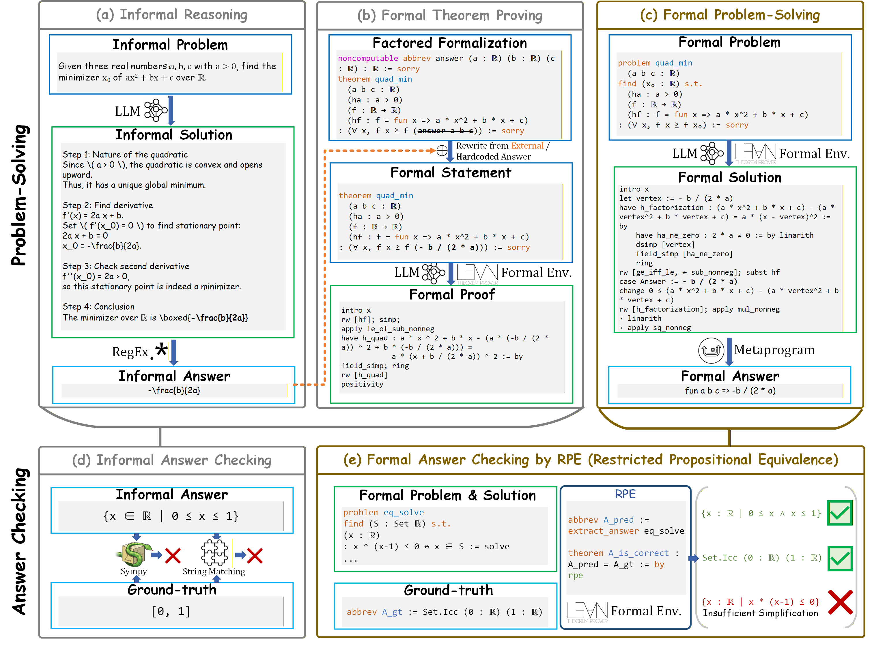

<div align="center">
  <h1><a href="https://openreview.net/forum?id=hgMZraPlSv">Beyond Theorem Proving: Formulation, Framework and Benchmark for Formal Problem-Solving</a></h1>
  <p><strong>ICML 2026 Spotlight</strong></p>
  <p>
    <a href="https://openreview.net/forum?id=hgMZraPlSv">Paper</a> |
    <a href="https://huggingface.co/collections/purewhite42/formal-problem-solving-681b573aac8f09f308bb7c66">Data</a> |
    <a href="#citation">Citation</a>
  </p>
  <br>
  
</div>

This repository contains the code and data for ICML'26 Spotlight _Beyond Theorem Proving: Formulation, Framework and Benchmark for Formal Problem-Solving_. The benchmarks support formal problem-solving (FPS), deductive FPS (D-FPS), and formal theorem proving (FTP) evaluation in Lean 4.

## Requirements

- [Lean 4](https://github.com/leanprover/lean4) `v4.15.0`
- [Mathlib 4](https://github.com/leanprover-community/mathlib4) `v4.15.0`
- [Aesop](https://github.com/leanprover-community/aesop) `v4.15.0`
- [Pantograph](https://github.com/lenianiva/Pantograph) `v0.2.25`

Install Pantograph and link `/path/to/Pantograph/.lake/build/bin/repl` to `common/pantograph/pantograph-repl`.

## Benchmarks

The released JSONL benchmarks are in `data/` and are synchronized with the Lean 4 project in `data/formal_problem_solving/`.

| JSONL File | Lean Directory | Benchmark | Size |
| --- | --- | --- | ---: |
| `data/formal_math500.jsonl` | `data/formal_problem_solving/FormalProblemSolving/FormalMath500` | FormalMath500 | 387 |
| `data/minif2f_solving.jsonl` | `data/formal_problem_solving/FormalProblemSolving/MiniF2FSolving` | MiniF2F-Solving | 375 |
| `data/putnam_solving.jsonl` | `data/formal_problem_solving/FormalProblemSolving/PutnamBenchSolving` | PutnamBench-Solving | 324 |

**FormalMath500** is a formalized subset of MATH500 with 387 samples covering Algebra, Intermediate Algebra, Number Theory, Prealgebra, and Precalculus.

**MiniF2F-Solving** refactors MiniF2F propositions into problem-solving instances with detached direct answers. It contains 375 samples from AIME, MATH-Algebra, AMC, IMO, and MATH-Number Theory.

**PutnamBench-Solving** refactors a subset of PutnamBench into 324 undergraduate-level problem-solving instances across algebra, analysis, number theory, geometry, linear algebra, combinatorics, abstract algebra, probability, and set theory.

The benchmarks are derived from existing open datasets: FormalMath500 uses informal problems and answers sampled from MATH under the MIT License; MiniF2F-Solving refactors the MiniF2F Lean subset under the Apache 2.0 License; PutnamBench-Solving refactors the PutnamBench Lean subset under the Apache 2.0 License. The released artifacts include the corresponding license files in the Lean benchmark directories.

Each JSONL record contains the following core fields:

- `informal_problem`: the natural-language problem statement.
- `informal_answer`: the natural-language ground-truth answer.
- `header`: Lean openings/options used before the formal problem.
- `independent_variables`: problem-level independent variables.
- `hypotheses`: assumptions rendered in the `s.t.` / `iff` block before the conclusion.
- `conclusions`: Lean propositions that the queried answer must satisfy.
- `formal_answer`: the formal ground-truth answer predicate in Lean 4.
- `formal_answer_type`: the Lean type of the direct answer.
- `metainfo`: benchmark name and sample index.

## Evaluation

In evaluator outputs, `proven` means that the generated Lean proof/solution is syntactically valid. For FPS and D-FPS, `solved` additionally requires the RPE answer-equivalence.


### Whole-Proof Generation for FPS/FTP

Use `--task fps` for FPS and `--task tp` for FTP.
Supported whole-proof agents include DeepSeek-Prover-V1.5 (`deepseek_prover_v15`), DeepSeek-Prover-V2-CoT (`deepseek_prover_v2_cot`), DeepSeek-Prover-V2-nonCoT (`deepseek_prover_v2_noncot`), Goedel-Prover (`goedel_prover`), Goedel-Prover-V2 (`goedel_prover_v2`), Kimina-Prover (`kimina_prover`), STP (`stp`), TheoremLlama (`theoremllama`), and Prompting generalist LLMs (`prompt`).


```shell
ulimit -s unlimited
python main.py \
  --log_root /path/to/output \
  --task ... \
  --agent ... \
  --benchmark ... \
  --benchmark_root ./data \
  --project_root ./data/formal_problem_solving \
  --num_samples_per_trial ... \
  --num_concurrency ... \
  --gen_base_url http://vllm.endpoint/v1 \
  --gen_api_key "some_api_key" \
  --gen_model_name /path/to/model
```

### Proof Search for FPS/FTP

Use `--task fps` for FPS and `--task tp` for FTP.
Supported proof search agents include InternLM2.5-StepProver (`stepprover`) and Lean-STaR (`leanstar`).

```shell
ulimit -s unlimited
python main.py \
  --log_root /path/to/output \
  --task fps \
  --agent ... \
  --benchmark ... \
  --benchmark_root ./data \
  --project_root ./data/formal_problem_solving \
  --max_search_trials ... \
  --num_tactics_per_trial ... \
  --temperature ... \
  --max_tokens ... \
  --num_concurrency ... \
  --gen_base_url http://vllm.endpoint/v1 \
  --gen_api_key "some_api_key" \
  --gen_model_name /path/to/model
```

### D-FPS

Supported D-FPS agents include direct in-context prompting (`direct_icl`) and hybrid CoT (`hybrid_cot`).

```shell
ulimit -s unlimited
python main.py \
  --log_root /path/to/output \
  --task d-fps \
  --agent ... \
  --benchmark ... \
  --demonstration_path ./data/prompt_hybrid_cot_final.jsonl \
  --benchmark_root ./data \
  --project_root ./data/formal_problem_solving \
  --try_num ... \
  --temperature ... \
  --max_tokens ... \
  --num_concurrency ... \
  --solver_base_url https://openai-compatible.endpoint/v1 \
  --solver_api_key "some_api_key" \
  --solver_model_name your-general-llm
```

### Export And Build Lean Benchmark

Regenerate the Lean benchmark project from the released JSONL source:

```shell
python common/export_fps_benchmark.py \
  --data_root data \
  --output_root data/formal_problem_solving \
  --benchmark all
```

Then build the Lean project:

```shell
cd data/formal_problem_solving
lake build
```


## Evaluation Results

### FPS

| Benchmark | Method | Model | Proven | Typecheck | Solved |
| --- | --- | --- | ---: | ---: | ---: |
| FormalMath500 | Proof Search | InternLM2.5-StepProver | 49.53±0.30% | 43.93±0.93% | 27.22±1.33% |
| FormalMath500 | Proof Search | LeanSTaR | 55.49±2.48% | 40.14±1.87% | 25.06±0.78% |
| FormalMath500 | Whole-Proof | DeepSeekProver-V1.5 | 47.89±0.54% | 9.13±0.39% | 8.01±0.26% |
| FormalMath500 | Whole-Proof | Goedel-Prover | 53.49±0.93% | 4.39±1.79% | 3.53±1.42% |
| FormalMath500 | Whole-Proof | Kimina-Prover | 60.38±0.98% | 31.52±0.45% | 30.32±0.15% |
| FormalMath500 | Whole-Proof | DeepSeek-Prover-V2 non-CoT | 68.91±0.65% | 0.43±0.39% | 0.43±0.39% |
| FormalMath500 | Whole-Proof | DeepSeek-Prover-V2 CoT | 72.18±1.04% | 34.80±0.65% | 33.68±1.04% |
| FormalMath500 | Whole-Proof | STP | 50.82±1.17% | 9.39±0.65% | 6.55±0.15% |
| FormalMath500 | Whole-Proof | Goedel-Prover-V2-8B | 80.19±0.15% | 68.04±0.75% | 59.17±0.26% |
| FormalMath500 | Prompt | DeepSeek-V3.2 | 39.79% | 18.35% | 14.99% |
| FormalMath500 | Prompt | Sonnet-4.5 | 30.23% | 7.75% | 6.72% |
| FormalMath500 | DSP+ | DeepSeek-V3.2+BFS-Prover-V1-7B | 20.93% | 30.49% | 28.42% |
| MiniF2F-Solving | Proof Search | InternLM2.5-StepProver | 55.91±0.41% | 39.20±0.46% | 29.51±0.81% |
| MiniF2F-Solving | Proof Search | LeanSTaR | 50.93±0.46% | 34.31±1.08% | 25.16±1.20% |
| MiniF2F-Solving | Whole-Proof | DeepSeekProver-V1.5 | 59.11±1.01% | 1.24±0.81% | 0.80±0.46% |
| MiniF2F-Solving | Whole-Proof | Goedel-Prover | 63.02±0.41% | 0.36±0.15% | 0.36±0.15% |
| MiniF2F-Solving | Whole-Proof | Kimina-Prover | 72.80±0.27% | 32.00±0.46% | 31.91±0.62% |
| MiniF2F-Solving | Whole-Proof | DeepSeek-Prover-V2 non-CoT | 75.56±0.62% | 0.09±0.15% | 0.09±0.15% |
| MiniF2F-Solving | Whole-Proof | DeepSeek-Prover-V2 CoT | 78.40±0.71% | 22.67±1.87% | 22.40±1.62% |
| MiniF2F-Solving | Whole-Proof | STP | 61.33±0.46% | 2.31±1.08% | 1.96±1.11% |
| MiniF2F-Solving | Whole-Proof | Goedel-Prover-V2-8B | 86.22±0.15% | 69.07±0.53% | 65.87±0.46% |
| MiniF2F-Solving | Prompt | DeepSeek-V3.2 | 42.40% | 17.87% | 16.27% |
| MiniF2F-Solving | Prompt | Sonnet-4.5 | 33.33% | 8.53% | 8.27% |
| MiniF2F-Solving | DSP+ | DeepSeek-V3.2+BFS-Prover-V1-7B | 23.47% | 23.20% | 21.60% |
| PutnamBench-Solving | Proof Search | InternLM2.5-StepProver | 1.54±0.00% | 27.06±1.98% | 0.00±0.00% |
| PutnamBench-Solving | Proof Search | LeanSTaR | 0.82±0.18% | 27.88±1.70% | 0.31±0.00% |
| PutnamBench-Solving | Whole-Proof | DeepSeekProver-V1.5 | 0.93±0.00% | 7.51±0.64% | 0.10±0.18% |
| PutnamBench-Solving | Whole-Proof | Goedel-Prover | 0.62±0.00% | 9.57±0.82% | 0.00±0.00% |
| PutnamBench-Solving | Whole-Proof | Kimina-Prover | 1.54±0.00% | 12.14±0.47% | 0.93±0.00% |
| PutnamBench-Solving | Whole-Proof | DeepSeek-Prover-V2 non-CoT | 1.95±0.47% | 4.84±0.36% | 0.00±0.00% |
| PutnamBench-Solving | Whole-Proof | DeepSeek-Prover-V2 CoT | 2.67±0.18% | 12.96±0.00% | 0.62±0.00% |
| PutnamBench-Solving | Whole-Proof | STP | 0.62±0.00% | 10.19±0.62% | 0.00±0.00% |
| PutnamBench-Solving | Whole-Proof | Goedel-Prover-V2-8B | 2.88±0.89% | 17.18±5.81% | 1.03±0.18% |
| PutnamBench-Solving | Prompt | DeepSeek-V3.2 | 0.93% | 2.47% | 0.00% |
| PutnamBench-Solving | Prompt | Sonnet-4.5 | 0.62% | 0.31% | 0.00% |
| PutnamBench-Solving | DSP+ | DeepSeek-V3.2+BFS-Prover-V1-7B | 0.31% | 9.57% | 0.00% |

### D-FPS

| Benchmark | Method | Model | Typecheck | Solved |
| --- | --- | --- | ---: | ---: |
| FormalMath500 | Direct | DeepSeek-V3.2 | 30.49% | 29.46% |
| FormalMath500 | Hybrid CoT | DeepSeek-V3.2 | 50.65% | 48.58% |
| FormalMath500 | Direct | Sonnet-4.5 | 20.67% | 20.16% |
| FormalMath500 | Hybrid CoT | Sonnet-4.5 | 24.03% | 23.26% |
| MiniF2F-Solving | Direct | DeepSeek-V3.2 | 41.60% | 40.80% |
| MiniF2F-Solving | Hybrid CoT | DeepSeek-V3.2 | 58.93% | 57.33% |
| MiniF2F-Solving | Direct | Sonnet-4.5 | 28.53% | 28.00% |
| MiniF2F-Solving | Hybrid CoT | Sonnet-4.5 | 29.33% | 28.53% |
| PutnamBench-Solving | Direct | DeepSeek-V3.2 | 0.93% | 0.00% |
| PutnamBench-Solving | Hybrid CoT | DeepSeek-V3.2 | 7.41% | 1.54% |
| PutnamBench-Solving | Direct | Sonnet-4.5 | 0.31% | 0.00% |
| PutnamBench-Solving | Hybrid CoT | Sonnet-4.5 | 0.00% | 0.00% |


## Contributing
This project is released under the Apache 2.0 license. Please see the [LICENSE](./LICENSE) file for more information.

Feel free to discuss the paper/data/code with us through issues/emails!
- Qi Liu: purewhite@sjtu.edu.cn

## Citation

If you find our work helpful, please consider starring this repository and citing:

```bibtex
@inproceedings{
liu2026beyond,
title={Beyond Theorem Proving: Formulation, Framework and Benchmark for Formal Problem-Solving},
author={Qi Liu and Xinhao Zheng and Renqiu Xia and Xingzhi Qi and Qinxiang Cao and Junchi Yan},
booktitle={Forty-third International Conference on Machine Learning},
year={2026},
url={https://openreview.net/forum?id=hgMZraPlSv}
}
```
